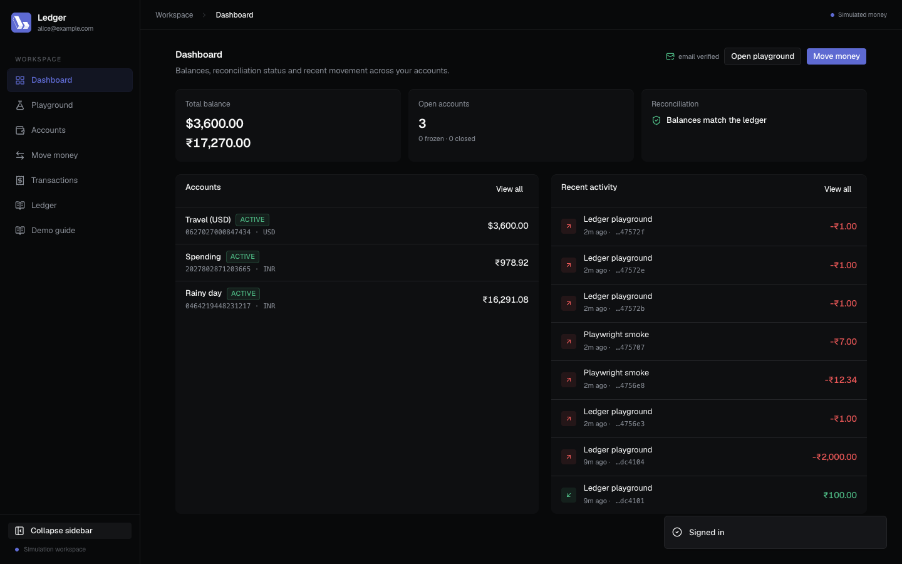
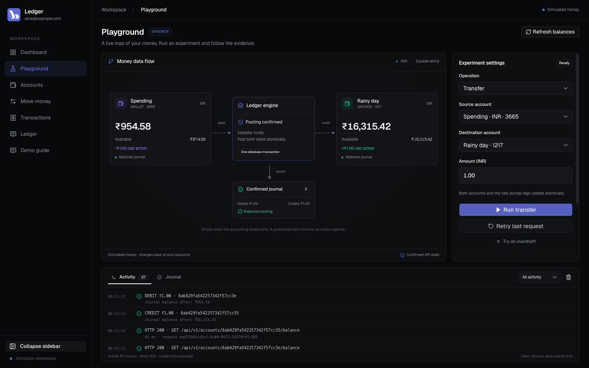
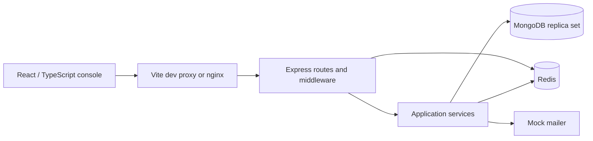

# Ledger

A double-entry ledger API and interactive banking simulation. Built with TypeScript, Express 5, MongoDB transactions, Redis, and React. All money is simulated.

Ledger demonstrates how to move money atomically, prevent overspending under concurrent requests, retry payments safely, reserve funds before settlement, and inspect the accounting evidence in a browser.



## Run the interactive demo

Prerequisite: Docker Desktop running with Docker Compose v2 or newer. No local Node installation or `.env` file is needed for this path.

```bash
docker compose --profile web up -d --build --wait
docker compose exec -T api node scripts/seed-demo.mjs
```

With Node.js 22 installed, the same two steps are available as:

```bash
npm run demo:up
```

Open **[Ledger demo guide](http://localhost:8080/demo)**. Read the demo credentials, then sign in as Alice through the sign-in form. The public guide never creates a session or switches your account. The guide explains what to do and what each result proves. These are real requests against MongoDB and Redis, not canned UI responses.

| Demo user | Email               | Purpose                                                     |
| --------- | ------------------- | ----------------------------------------------------------- |
| Alice     | `alice@example.com` | Three funded accounts: INR savings, INR wallet, USD current |
| Bob       | `bob@example.com`   | Funded INR account and counterparty                         |
| Admin     | `admin@example.com` | Reconciliation, reversal, unfreeze, audit log               |

All demo passwords: `Sup3rStrong!Pass`. Seeded users are email verified. Re-running the seed reuses users/accounts and payment keys; it does not repeatedly fund the same accounts. It does not reset actions you performed. Existing historical transactions created before request fingerprints were introduced may require a new key rather than replaying.

MongoDB is exposed on `127.0.0.1:27018` and Redis on `127.0.0.1:6380` to avoid colliding with native database services. Override with `LEDGER_MONGO_PORT` / `LEDGER_REDIS_PORT` and update host connection URIs if needed. Internal container ports remain 27017 / 6379.

The Docker configuration is a development sandbox with known credentials, mocked email, self-service deposits, and relaxed rate limits. Do not expose it as a production banking service.

### Money playground

Open **[Playground](http://localhost:8080/playground)** after signing in. Choose a source, a matching-currency destination, an amount, and an operation. Run a transfer, reserve a hold, capture or void it, deposit, withdraw, or deliberately try an overdraft.

- The GitHub-style data-flow diagram connects accounts, the atomic posting engine, and the confirmed journal. It uses responsive HTML/SVG without a graph-rendering dependency. Account blocks show posted balance, available funds, the change from the last action, and journal reconciliation.
- Labeled arrows animate only after a posted operation is confirmed. Holds show a reservation instead.
- The live timeline records actual browser requests, HTTP statuses, latency to response headers, request IDs, and confirmed journal legs. It never includes passwords, tokens, request bodies, or authorization headers. Authentication endpoints are excluded.
- **Retry last request** reuses the original payload and key. Compare the transaction ID and balances to verify no second payment. Captured holds are re-read from the database so replaying an old authorization response cannot make them appear pending again.
- New users can explicitly create two INR demo wallets funded with ₹1,000 and ₹250 through ledgered deposits. Setup reuses wallet/funding keys; it does not reset existing balances. Self-service funding must be enabled.
- **Clear timeline** clears browser events only. Actions persist in the shared demo database. The latest 200 events stay on the page; leaving clears the timeline. Other clients' activity appears when you refresh balances.

This is a visual client for the real API, not a stream of all server-internal logs. Use `npm run stack:logs` for the full container logs. The playground introduces no new privileged endpoints or authentication shortcuts.



### A five-minute interview demonstration

1. **Accounts:** compare cached balance and journal balance. Show INR and USD separately.
2. **Move money:** transfer ₹10 between Alice's INR accounts. Inspect the two equal ledger legs.
3. Send the identical request again, keeping its idempotency key. Show the original transaction and unchanged balance. Change the amount with the same key: `409 Conflict`.
4. **Hold:** reserve ₹5. Available balance decreases, while posted balance and journal do not change. Open the pending transaction and capture or void it.
5. Attempt an overdraft. Show the rejected request and unchanged accounting. The UI offers matching-currency destinations; use Swagger to test a rejected cross-currency request.
6. Sign in as **Admin**. Verify the books, reverse a completed transaction, and inspect its audit log. The reversal is a new opposite transaction; the original journal remains.

Interactive API reference: [Swagger UI](http://localhost:3000/docs). Health: [liveness](http://localhost:3000/health), [readiness](http://localhost:3000/ready).

[Recorded walkthrough](docs/demo/ledger-demo.mp4) · [Screenshots](docs/screenshots) · [Interview and architecture guide](docs/about.md)

## What works

- Registration, login, rotating refresh tokens, logout, password changes, failed-login lockout, and mock email verification.
- Owner-scoped accounts with zero opening balance; metadata updates, freeze, admin unfreeze, and closing only empty accounts.
- Transfers, deposits, withdrawals, holds, full capture, manual void, and admin reversals.
- Atomic posted balance updates, transaction record, and balanced journal entries inside MongoDB multi-document transactions.
- Conditional available-balance updates to prevent concurrent overspending.
- Per-user idempotency keys, Redis response replay and request ownership, and a unique MongoDB transaction key with a persistent request fingerprint.
- Statements, journal detail, per-account reconciliation, global debit/credit verification, and best-effort administrative audit logs.
- React console, responsive navigation, guided demo, Swagger reference, structured logs, and readiness checks.

Holds and audit logs are implemented. Automatic expiry cleanup, real email delivery, external payments, and production operations are not.

## Architecture and decisions



| Choice                                             | Why it is used                                                                                | Cost / alternative                                                                                                                                                              |
| -------------------------------------------------- | --------------------------------------------------------------------------------------------- | ------------------------------------------------------------------------------------------------------------------------------------------------------------------------------- |
| TypeScript + Node.js 22                            | Shared language, typed contracts, and efficient I/O for API/database work                     | Types do not validate network input; validators and tests remain necessary. CPU-heavy work needs workers.                                                                       |
| Express 5                                          | Explicit middleware order and small HTTP layer                                                | More validation, authorization, and dependency wiring than an opinionated framework.                                                                                            |
| MongoDB + Mongoose                                 | Document models, indexes, conditional updates, and multi-document transactions                | Requires a replica set. Cross-document correctness lives largely in service code. PostgreSQL would offer stronger relational constraints.                                       |
| Redis + ioredis                                    | Shared rate limits, response replay, request locks, and token revocation across API processes | Adds operational state and availability concerns. MongoDB remains the durable guard against duplicate payment commits.                                                          |
| Integer minor units                                | Exact representation of paise/cents within JavaScript's safe integer range                    | Formatting happens at the edges; no foreign exchange or arbitrary decimal precision. Accumulated balances still need explicit bounds before production scale.                   |
| Append-only journal through the API                | Reversals retain the original accounting and add a correction                                 | Database administrators can still alter records; this is not a tamper-proof journal.                                                                                            |
| JWT access + rotating refresh tokens               | Short access lifetime, session rotation, reuse detection                                      | Authentication still reads MongoDB and Redis. This is not a fully stateless auth system. Browser tokens use tab-scoped sessionStorage; injected JavaScript can still read them. |
| React 19 + Vite + Tailwind CSS 4 + shadcn/Radix UI | Interactive forms, transaction inspection, accessible component primitives, fast local builds | Client-side rendering and a separate build/proxy layer.                                                                                                                         |
| Docker Compose                                     | Reproducible API, UI, replica set, and Redis                                                  | Single-machine development environment, without production HA or TLS.                                                                                                           |

See [`docs/about.md`](docs/about.md) for transaction mechanics, alternatives, failure scenarios, interview questions, resume bullets, and limits.

## Local development

Prerequisites: Node.js 22, npm, Docker Desktop. Use lockfiles for reproducible installs.

```bash
npm ci
npm --prefix web ci
npm run infra:up
```

Copy `.env.example` to `.env` only if you do not already have one. For an existing local `.env`, update `MONGO_URI` to port `27018` and `REDIS_URL` to port `6380` to match this stack. Set separate `JWT_SECRET` and `JWT_REFRESH_SECRET` values with `openssl rand -hex 32`. Keep the example's `directConnection=true`: the Docker replica set advertises `mongo:27017`, which the host cannot resolve.

```bash
npm run dev
```

In another terminal:

```bash
npm run web:dev
```

API: `http://localhost:3000`. UI: `http://localhost:5173/demo`. The Vite proxy forwards `/api`, `/health`, and `/ready`. For mock verification links in this mode set `APP_URL=http://localhost:5173`. When using the host API, relax local test rate limits if needed; the Compose API already sets demo limits.

```bash
npm run seed
```

Do not run the host API and the container API on port 3000 simultaneously.

## Verification

Verified locally on 2026-11-12: 36 unit tests, 176 API checks, and 20 browser scenarios passed, plus 12 responsive/recovery/security browser checks. The browser suite also checks that the public guide requires manual sign-in and preserves the current account. API/web builds, ESLint, formatting, and both npm dependency audits also passed (zero reported vulnerabilities at verification time).

```bash
npm run check         # API types, ESLint, unit tests, API build, web build
npm test              # unit + real API integration tests; running stack required
npm run test:ui       # real Chrome; running seeded stack required
npm run docs:openapi  # regenerate docs/openapi.json
```

API tests create users and transactions and grant a test administrator in the configured database. Run against a disposable development database. They include authorization, validation, token replay, idempotency, concurrent debits, holds, reversals, and accounting invariants. UI tests use the seeded demo users and installed Google Chrome; set `BASE_URL` and `CHROME_PATH` to override discovery.

The browser suite covers playground balance changes, duplicate-request retries, hold capture/void, overdraft rejection, new-user wallet setup, and mobile layout.

The GitHub Actions workflow is configured to run checks, start a fresh Docker stack, seed data, run API and browser tests, and capture logs on failure. Remote CI results must be checked after pushing; the verification above was performed locally. Test counts belong to test output; avoid claiming throughput or latency without a measured load run. The k6 script in `tests/load/` is a starting point, not a benchmark result.

### Frontend reliability, mobile layout, and security

- Shadcn selects, menus, tabs, tooltips, cards, alerts, and scroll areas provide consistent controls. Desktop navigation collapses to centered icons with accessible labels and tooltips; the preference persists. Mobile navigation uses a keyboard-accessible drawer.
- The desktop playground fits the viewport with bounded settings/activity panels. Tablet/mobile screens use one page-scroll owner and a stacked diagram. Short desktop heights can scroll the main content rather than clipping it; the browser document itself has no extra scrollbar.
- All screens load through route-level dynamic imports and skeleton fallbacks. App, route, and diagram error boundaries show recovery actions without exposing stack traces. A failed route can be left using the existing navigation.
- Geist is self-hosted with `font-display: swap`, avoiding external font calls. Hashed assets receive immutable cache headers; HTML revalidates, missing assets return 404, and API responses use `no-store`.
- Nginx serves a Content Security Policy, anti-framing, no-sniff, referrer, and permissions headers. CSP allows inline **styles** for Radix positioning, but no inline scripts or eval. Access logs omit query strings to avoid retaining verification tokens. These headers apply to the built nginx app, not the Vite development server.
- Tokens use validated tab-scoped `sessionStorage`. Legacy `localStorage` token copies are removed; existing users sign in once again. Refresh responses cannot restore a logged-out session. This reduces persistence but does not eliminate XSS risk; HttpOnly-cookie/BFF authentication remains a production improvement.
- Public demo metadata includes descriptions, social tags, and a canonical URL without query parameters. Private screens use `noindex,nofollow`. This is a client-rendered app; metadata is not a claim of server rendering, search ranking, or a deployed public URL.

```bash
npm run test:responsive  # five viewport widths, sidebar, metadata, headers, caching, route recovery
```

## Useful commands and troubleshooting

```bash
npm run stack:ps
npm run stack:logs
npm run stack:stop       # preserve containers and data
npm run stack:down       # remove containers; preserve named data volumes
npm run demo:up          # build, start, wait, seed
```

`npm run stack:reset` deletes named database volumes and all demo data. Use it only when you intend to discard that data.

| Symptom                                  | Fix                                                                                                       |
| ---------------------------------------- | --------------------------------------------------------------------------------------------------------- |
| Cannot connect to Docker                 | Start Docker Desktop, then retry `npm run demo:up`. Deleted containers are recreated automatically.       |
| Port 27018, 6380, 3000, or 8080 occupied | Stop the conflicting service or override the Compose host port.                                           |
| Host API cannot resolve `mongo`          | Use the `.env.example` MongoDB URI with `directConnection=true`.                                          |
| Transaction numbers / replica-set error  | Use the Compose MongoDB replica set; standalone MongoDB cannot run these transactions.                    |
| Demo login fails                         | Run the container seed command. If an existing demo password was changed, the seed does not overwrite it. |
| `429 Too Many Requests`                  | Wait for the rate-limit window or use the Compose demo API's relaxed limits.                              |
| Frozen account blocks demo seed          | Unfreeze it as Admin; seeding preserves account state.                                                    |
| UI test cannot launch Chrome             | Install Chrome or set `CHROME_PATH` to a supported browser executable.                                    |

## Sharing an interactive version

The local guide is fully interactive at `http://localhost:8080/demo`. No public URL is provisioned by this repository. To show it during an interview, run the stack and share your browser. For a resume link, host the same containers on a dedicated demo machine behind HTTPS and use isolated, disposable data. Keep MongoDB and Redis private; their Compose host ports bind to loopback. Choose demo-specific credentials and set proxy trust to the actual topology.

A static frontend host alone cannot run this project: it also needs the API, a MongoDB replica set, and Redis. A public demo should add periodic data reset, resource limits, abuse controls, backups appropriate to its data, and a clear simulation label. Real production deployment needs the further work listed in the architecture guide.

## Project map

```text
src/api/                  HTTP routes, controllers, validators, middleware
src/application/services/ account, transaction, ledger, auth, verification, audit
src/domain/entities/      domain types
src/infrastructure/       Mongoose models/repositories, Redis, mock email
src/shared/               config, errors, logging, utilities, dependency wiring
web/src/                  React screens, API client, demo guide, components
scripts/                  demo seed, admin promotion, OpenAPI export
tests/                    unit, API integration, k6 load script
web/tests/                Chrome smoke tests and recorded demo automation
docs/                     interview guide, API reference, security, diagrams
```

Additional reference: [API contract](docs/api-reference.md), [OpenAPI JSON](docs/openapi.json), [security notes](docs/security.md), [flow diagrams](docs/flow-diagrams.md).
